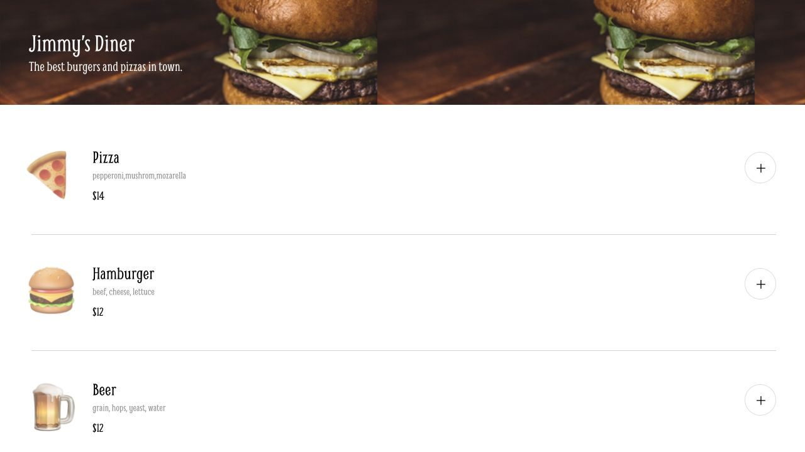

# Jimmy’s Diner Ordering App



Jimmy’s Diner is a small browser-based ordering app built with HTML, CSS, and vanilla JavaScript, with accessibility considered throughout the ordering flow. Customers can browse a menu, build an order, and review the total before completing a demo checkout.

## Features

- Menu items and prices are rendered from data in `data.js`.
- Add menu items to an order and see quantities and prices update.
- Remove items and review the updated order total.
- Complete checkout through a card details dialog and see an order confirmation.
- Keyboard and screen-reader support is built into key ordering interactions.

## Project Structure

- `assets/` contains the menu and header images.
- `css/` contains the shared styles, utility classes, and component styles.
- `data.js` defines the menu and stores the current order state.
- `index.html` contains the page markup.
- `index.js` renders the menu and handles order and checkout interactions.
- `vite.config.js` contains the Vite configuration.

## Build

Install the project dependencies:

```sh
npm install
```

Create a production build:

```sh
npm run build
```

The generated site is written to `dist/`. Preview the production build locally with:

```sh
npm run preview
```

## Run

Start the Vite development server:

```sh
npm run dev
```

Open the local URL printed in the terminal. `npm start` is also configured to start the development server.

## Design Highlights

- **Data-driven menu:** menu cards are generated from the item records in `data.js`.
- **Order state:** a `Map` tracks each selected item’s quantity and accumulated price.
- **Accessible feedback:** live announcements describe order changes, and keyboard focus is managed when using the checkout dialog and removing items.

## Notes

Checkout is a front-end demonstration. It does not process payments or send orders to a restaurant. The project currently has no automated test script.
